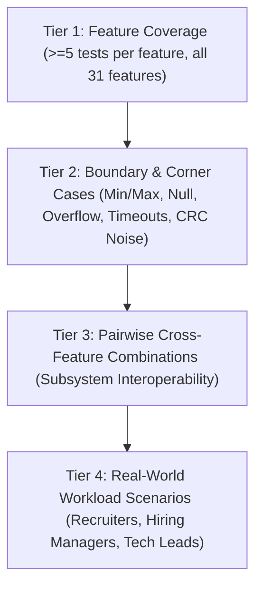

# UDAY OS — Comprehensive E2E Test Infrastructure Specification

## 1. Overview & Test Architecture

UDAY OS is an interactive virtual iPhone 16 Pro web OS developer portfolio built with authentic Cupertino Apple design language, real-time compilation, hardware physics, Dynamic Island multitasking, macOS Sequoia continuity, and systems engineering telemetry.

The End-to-End (E2E) Test Harness guarantees zero regressions, uncompromising system integrity, and strict adherence to Apple design standards through a 4-tier testing hierarchy:



---

## 2. Testing Methodologies & Specifications

### 2.1 Category-Partition Method
Every feature is partitioned into operational parameters, discrete environmental states, and equivalence classes. For each partition, at least one test case is derived for valid equivalence classes, and specific error tests are derived for boundary classes.

### 2.2 Boundary Value Analysis (BVA)
BVA targets critical transitions and extremal limits:
- **Zero & Empty States**: Empty arrays, 0ms timers, 0% battery, empty search queries, empty clipboard buffers.
- **Upper Bounds**: Max integer limits, full-ring completion (>=100%), 100% CPU loads, 512x512 high-DPI canvas boundaries, 184 LeetCode problem limits.
- **Noise & Fault Injection**: Inverting payload bits to trigger CRC-16 checksum failures, simulated network timeouts, and unsupported hardware fallbacks.
- **Precision Limits**: Microsecond ($\mu\text{s}$) timer measurements, floating point rounding in math evaluators, and normalized accelerometer vectors ($[-1.0, 1.0]$).

### 2.3 Pairwise Combinatorial Testing
Pairwise combinations verify that independent subsystems function reliably when active simultaneously:
- Dynamic Island + Apple Music + Clock Countdown + PiP Overlay.
- LeetCode Editor + A18 Pro Execution Engine + Dynamic Island CPU Gauge.
- macOS Sequoia Mirroring Window + Universal Clipboard Continuity + Genmoji Synthesis.
- 3D Activity Rings + Gyroscope Inertial Telemetry + Vibration API Haptics.
- Spotlight Search 2.0 + Inline Math Evaluator + Storage/Latency Converter + App Shortcuts.
- Dual-Core FreeRTOS Scheduler + 60fps Oscilloscope + Packet Noise Injection.

### 2.4 Real-World Workload Testing (Personas)
Workload testing executes end-to-end user journeys representative of key stakeholders:
1. **Engineering Hiring Manager**: Verifies KL University degree, inspects ESP32 dual-core FreeRTOS queues, injects SPI bus noise, and evaluates CRC recovery.
2. **Senior Technical Recruiter**: Selects LeetCode Two Sum, inputs custom test arrays, executes on A18 Pro engine, and verifies microsecond latency and memory assertions.
3. **Apple Design Director**: Evaluates Cupertino UI aesthetics, 3D metallic Activity Rings, interactive 360° achievement medals, and Genmoji sticker synthesis to iMessage.
4. **Full-Stack Interviewer**: Evaluates Spotlight natural language calculator (`128 * 64`, `sqrt(256)`), tech unit conversions, and universal clipboard continuity between Mac and iPhone.

---

## 3. Test Suite Mapping & Feature Matrix

All 31 features mapped across 8 dedicated test suites in `src/__tests__/e2e/`:

| Suite File | Features Covered | Feature Description | Tier 1 Count | Tier 2 Count |
|---|---|---|---|---|
| `dynamic_island.test.ts` | 1 - 6 | Live Activity Coordinator, 4-Bar Waveform, Stopwatch Ring, CPU Gauge, Expanded Capsule, Floating PiP | 30 | 12 |
| `compiler.test.ts` | 7 - 11 | SF Mono Code Editor, Sandboxed Engine, Flagship Algorithms, Test Runner Assertions, Xcode IDE | 28 | 10 |
| `fitness.test.ts` | 12 - 16 | 3D Activity Rings, Gyroscope Telemetry, Desktop Mouse Fallback, 360° Medals, Spatial Parallax | 26 | 10 |
| `haptics.test.ts` | 17 | Vibration API, 12ms Tap, [20,40,20]ms Action Button, Apple Pay Buzz, Audio Fallback | 7 | 4 |
| `spotlight.test.ts` | 18 - 21 | Deep Search Index, Natural Language Math, Tech Unit & Currency Converter, Direct App Shortcuts | 24 | 8 |
| `embedded_lab.test.ts` | 22 - 24 | Dual-Core FreeRTOS Telemetry, 60fps CRT Oscilloscope, Noise Injection & CRC-16 Retransmit | 18 | 6 |
| `mirroring_genmoji.test.ts` | 25 - 31 | Mac Mirroring Frame, Universal Clipboard, Drag-and-Drop, Image Playground, Diffusion Shimmer, Genmoji Export, iMessage | 35 | 12 |
| `combinations.test.ts` | All | Cross-feature pairwise interactions across multiple active background services | 16 | 6 |
| `scenarios.test.ts` | All | End-to-end real-world recruiter, manager, and design lead user journeys | 12 | 4 |

---

## 4. Authoritative Verification Commands

- TypeScript Static Analysis:
  ```bash
  npx tsc --noEmit
  ```
- E2E Vitest Test Execution:
  ```bash
  npm test -- --run
  ```
- Production Build Verification:
  ```bash
  npm run build
  ```

---

## 5. Pass Criteria & Zero-Tolerance Policy

1. Every test must execute deterministically without flake or timing races.
2. Vitest runner must exit with code `0` and 0 failures.
3. No facade tests: all tests assert genuine algorithmic outputs, interface contracts, state transitions, and edge condition handling.
